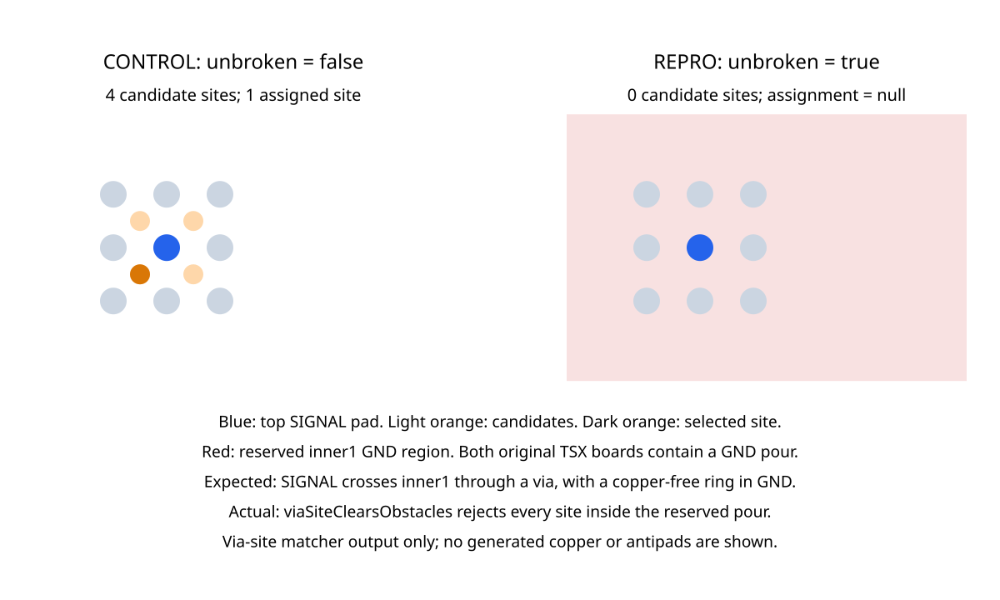

# Reproduction: reserved ground plane rejects every via site

This reproduction calls this checkout's `matchComponentDogboneViaSites` and
`getComponentDogboneViaSiteCandidates` directly. It supersedes the caller-level
reproduction in [dogbone-solver #10](https://github.com/tscircuit/dogbone-solver/pull/10).
No production code or dependency versions change.

```sh
bun install
bun test tests/unbroken-plane-via-sites.test.ts
```



The standalone [TSX example](../examples/unbroken-plane.circuit.tsx) explicitly
lists all nine pads of a 0.8 mm pitch grid. Its center pad carries SIGNAL on top;
the requested escape layer is inner2. Both cases contain an inner1 GND pour.
Only `unbroken` changes. `routeRemaining={false}` isolates the local escape.

| Only changed TSX prop | Candidate sites | Assignment |
| --- | --- | --- |
| `unbroken={false}` | 4 | One selected site |
| `unbroken={true}` | 0 | `null` |

Expected: SIGNAL can cross the intermediate GND plane through a via, with a
copper-free ring (antipad) keeping the two nets separate. Actual: the shared
`viaSiteClearsObstacles` helper treats the reserved pour as a solid obstacle.
Its distance test eliminates every candidate. The current source-segment check
already filters obstacles by layer; this reproduction targets the via check.

The two JSON fixtures are unchanged `solver:started` constructor inputs captured
from the TSX using stock core 0.0.2323 and props 0.0.724. They contain no saved
routes. The test passes their full obstacle lists to the local helpers, using
the local `prepareFanoutBuses` function to construct the shared helper's bus
argument. The prepared buses are identical. No dogbone solver is imported.

The single test records the current failure alongside its passing control. Its
snapshot displays the helper's returned candidate/selected positions, not
completed routes or generated antipads. Passing CI confirms the defect is
reproduced. A fix should update the failing-case assertions and snapshot, retain
real obstacle clearance, and verify actual foreign-net isolation in core.

## Recapture the TSX inputs

Copy both files from `examples/` into an existing tscircuit project with core
0.0.2323 and props 0.0.724, then run:

```sh
bun examples/capture-unbroken-plane.mjs
```

The script only observes the native dogbone `solver:started` event; it neither
replaces an algorithm nor edits the input. It writes the two JSON files in the
project's working directory. The TSX was independently rendered and typechecked
with those versions; its SHA-256 is
`016a83e05b924a9dbe1979567a1066cc4caf9488911f6442bfc9aeca8a9c04ce`.
The standalone example requires newer core/props than this repository's pinned
generator workspace; it is excluded from the repository typecheck. CI tests
the captured inputs directly against the local helper implementation.

To intentionally update the snapshot:

```sh
BUN_UPDATE_SNAPSHOTS=1 bun test tests/unbroken-plane-via-sites.test.ts
```

Related design discussion: [dogbone-solver #4](https://github.com/tscircuit/dogbone-solver/pull/4).
This PR does not implement that proposal or claim that the full motherboard
routes after this defect is fixed.
